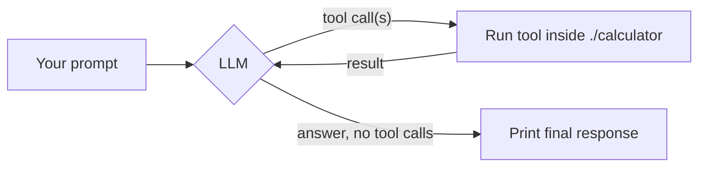

# python-ai-agent

[](https://github.com/nathan-renard/python-ai-agent/actions/workflows/tests.yml)


A command-line coding agent in Python. You describe a task in plain English, and the agent works out which tools to call: it lists folders, reads files, runs Python and writes changes inside one sandboxed project folder, looping with the LLM until it has an answer.

```console
$ uv run main.py "Run the calculator's tests and tell me whether they pass"
 - Calling function: get_files_info
 - Calling function: run_python_file
Final response:
All 9 tests pass.
```

Nobody told it where the tests live or how to run them. It listed the folder, found `tests.py`, ran it and read the output. Add `--verbose` to see each call's arguments, the tool's raw result and token usage per round.

Built while working through [Boot.dev](https://www.boot.dev)'s *Build an AI Agent in Python* course. The course uses Google's Gemini SDK; this version talks to [OpenRouter](https://openrouter.ai) through the OpenAI SDK instead, so any model OpenRouter serves can drive it. On top of the course material it adds symlink-safe path checks, full type annotations (`mypy --strict` passes), and 312 offline test checks.

## How it works



1. `main.py` sends the system prompt, your prompt and the JSON schemas of four tools.
2. When the model asks for tools, `call_function.py` runs each one and adds the result to the conversation.
3. The full history goes back to the model, and this repeats until it answers without calling a tool. After 20 rounds (`MAX_ITERATIONS`) the agent gives up and exits with code 1.

| Tool | What it does |
| --- | --- |
| `get_files_info` | Lists a directory: each entry's name, size and whether it's a folder |
| `get_file_content` | Reads a file, cut off at 10,000 characters |
| `run_python_file` | Runs a `.py` file with optional arguments and returns its exit code, stdout and stderr |
| `write_file` | Creates or overwrites a file, making any missing parent folders |

## Guardrails

Letting a model run code and write files is the risky part, so every tool goes through the same checks:

- **The model never picks the folder.** `call_function.py` sets the working directory after parsing the model's arguments and overwrites anything the model sent.
- **No escaping the folder.** Paths are resolved with `os.path.realpath`, then compared with `os.path.commonpath`. That rejects `../` tricks and symlinks that point outside the folder.
- **Only Python runs.** The `.py` check happens on the resolved path, so a `script.py` symlink that points to some other file is refused.
- **No shell.** Scripts run through `subprocess` with an argument list, never `shell=True`, so arguments are passed as-is. Each run times out after 30 seconds.
- **Bounded output.** File reads stop at 10,000 characters so one big file can't flood the context.
- **Errors go back to the model.** Tools return error strings instead of raising, so the model can read what went wrong and try something else.

## Tests

312 checks across six suites, one per tool plus dispatch and the agent loop. The OpenRouter client is mocked, so they run offline with no API key. Each suite is organised by test-design technique (equivalence partitions, boundary values, decision tables, use cases, error guessing) and covers cases like symlink escapes, unreadable files, non-UTF-8 output, timeouts, providers that send `null` tool arguments, and hitting the iteration limit.

| Suite | Covers | Checks |
| --- | --- | ---: |
| `test_get_files_info.py` | Listing directories | 31 |
| `test_get_file_content.py` | Reading and truncation | 39 |
| `test_write_file.py` | Writing files and folders | 50 |
| `test_run_python_file.py` | Running scripts, exit codes, timeouts | 78 |
| `test_function_calls.py` | Dispatch and working-directory injection | 61 |
| `test_agent_loop.py` | Message history, iteration limit, verbose output | 53 |

```console
for t in test_*.py; do uv run python "$t"; done
```

Each suite prints `PASS`/`FAIL` per check and a total, and exits with code 1 if any check failed. GitHub Actions runs `mypy --strict` and all six suites on every push to `main` and on pull requests.

## Run it

You need Python 3.14, [uv](https://docs.astral.sh/uv/) and an [OpenRouter API key](https://openrouter.ai/keys) (the free tier works).

```console
git clone https://github.com/nathan-renard/python-ai-agent.git
cd python-ai-agent
uv sync
echo 'OPENROUTER_API_KEY=your-key-here' > .env
uv run main.py "How does the calculator handle operator precedence?"
```

By default it uses `openrouter/free`, which routes to whichever free model is available. Change `MODEL` in `main.py` to pin a specific one.

## Layout

```text
main.py            CLI and the agent loop
call_function.py   Tool schemas offered to the model, dispatch, working-directory injection
prompts.py         System prompt
config.py          Limits: MAX_CHARS, TIMEOUT_SECONDS, MAX_ITERATIONS
functions/         The four tools, each next to its JSON schema
calculator/        Sample project the agent works on
test_*.py          Test suites
```

## Limitations

- The working directory is hard-coded to `./calculator`. A `--dir` flag is the obvious next step.
- This is a path sandbox, not a process sandbox. Code run by `run_python_file` has your user's permissions, so untrusted code would need a container.
- API failures (network errors, rate limits) and malformed tool arguments from the model aren't handled yet. The tests pin down the current behaviour so the fix will show up as a deliberate change.
- One prompt per run. There's no back-and-forth chat yet.
